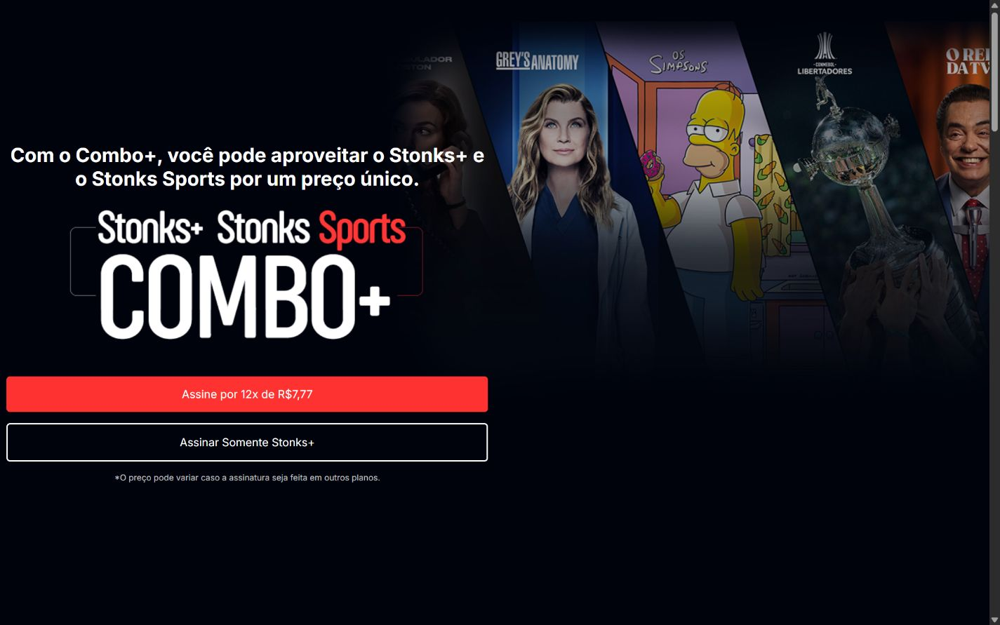
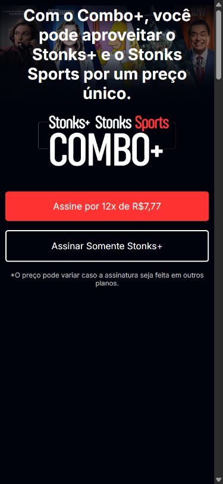

# Stonks+

Landing page de um serviço fictício de streaming, criada para praticar composição de páginas e CSS responsivo.

**HTML · CSS · Grid · Flexbox**

**Estado:** Estudo de interface — legado.



Capturas reais da interface servida localmente. As imagens apresentam o estado atual do código.

<details>
<summary>Ver no celular</summary>

Captura da interface no celular.



</details>

## O que demonstra

Seções comerciais, planos ilustrativos, apresentação de dispositivos e layout adaptável.

## Executar localmente

Na pasta do projeto, inicie um servidor estático:

```bash
python -m http.server 8000
```

Abra `http://localhost:8000`. Não há etapa de build.

[Endereço histórico da demonstração](https://stonks-plus.vercel.app/)

## Escopo

Este repositório contém uma página estática. Reprodução de vídeos, download de conteúdo, contas, cobrança e assinaturas não foram implementados. Preços e ofertas são fictícios. As imagens foram utilizadas em um exercício de estudo.
